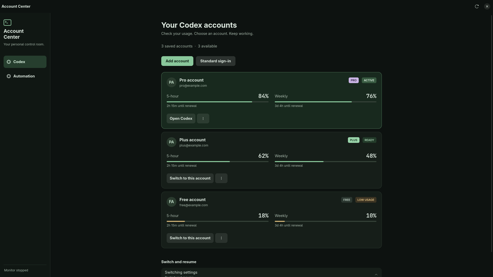

# Codex Account Center

A quiet, Matrix-inspired account manager for Codex on Linux. See account plans
and remaining usage, switch saved accounts, and optionally resume interrupted chats.

**Unofficial and experimental.** This project is not affiliated with OpenAI.
It targets a Linux desktop packaging layout with `chatgpt` installed at
`/usr/bin/chatgpt` and its main executable at `/usr/lib/chatgpt/ChatGPT`.
Other layouts and official desktop platforms have not been validated.



## Features

- GTK 4 / Libadwaita interface with a restrained dark green theme.
- Account plan labels from the service, including plans beyond Plus.
- Five-hour and weekly usage, renewal times, and available reset credits.
- Manual switching with serialized account writes and verified desktop startup.
- Optional background switching at a configurable remaining-usage threshold.
- Captures multiple unfinished root chats before a restart and resumes them individually.
- Uncertain continuation delivery is reported instead of blindly sent again.

## Requirements

- Linux with Python 3.10+, PyGObject, GTK 4 and Libadwaita 1.4+.
- The compatible `chatgpt` desktop layout described above, plus Codex CLI for sign-in.
- A desktop session with D-Bus. systemd user services for optional automation.
- `notify-send` for notifications. Chromium, Firefox or Zen for browser sign-in.
- Hyprland window checks are supported; other desktops use process and IPC readiness.

On Arch Linux, the GUI packages are `python-gobject`, `gtk4` and `libadwaita`.
Install dependencies through your distribution's package manager. Use system Python
so that its PyGObject bindings are available.

## Install

Review the source first, then run from this directory:

```sh
./install.sh
~/.local/bin/codex-acc
```

The installer runs without sudo, does not change accounts, and does not enable
or restart automation. It refuses to overwrite an existing installation unless
`--replace` is supplied; that option first backs up installed program files.
An already-running monitor keeps its existing state until you restart it.

Add accounts through **Add account** and complete the normal Codex sign-in flow.
Use only accounts you are authorized to access. Account entitlements and service
usage limits remain controlled by the provider; this tool does not reset them.

## Automation

Review **Automation** and the **Switching settings** in the app before enabling
the service. Automatic switching may restart the desktop app; automatic continuation
sends the configured message to eligible unfinished chats.

A single dry-run check (reads usage without switching):

```sh
python3 ~/.local/share/codex-auto-switch/codex_auto_switch.py
```

Enable or stop the monitor through the app, or:

```sh
systemctl --user enable --now codex-auto-switch.service
systemctl --user disable --now codex-auto-switch.service
```

## CLI

```sh
codex-acc --help
codex-acc list
codex-acc add
codex-acc switch ACCOUNT
codex-acc resume
```

`switch` accepts an account number or matching email. `resume` explicitly resumes
the latest chat; automatic continuation instead filters for unfinished root chats.

## Privacy and data

Credentials stay under `~/.codex/`: `auth.json` is the active session,
`accounts/` holds saved authentication files and settings. These are sensitive
plaintext credentials protected by local file permissions, not an encrypted vault.
The app contacts OpenAI authentication and usage endpoints; it has no project
telemetry or account-upload backend. Local desktop IPC and read-only chat databases
are used for continuation. Sign-in opens the provider's normal browser flow.

This public edition contains **no browser account directory, saved email quick list,
browser profile manager, browser-cookie reader, or Antigravity integration**.
The screenshot uses fictional accounts. Never attach your account files, raw logs,
chat databases or personal screenshots to an issue.

## Compatibility and limitations

Desktop IPC, local database schemas and usage endpoints are version-dependent.
An app update may require changes here. Live plan lookup can fail; an unverified plan is labeled unknown. Missing usage
is reported as unavailable. Sign-in and live account switching are not part of CI.
The test suite covers isolated launch, continuation and account-selection logic;
it does not guarantee uninterrupted operation across all desktop versions.

## Development

```sh
python3 -m unittest discover -s tests -v
python3 -m py_compile src/codex-acc src/codex_auto_switch.py
```

Tests use temporary data and mocked desktop/network calls. Keep runtime state
outside this repository. See [SECURITY.md](SECURITY.md) before reporting a bug.

## License

MIT. Contributions and compatibility reports are welcome.
